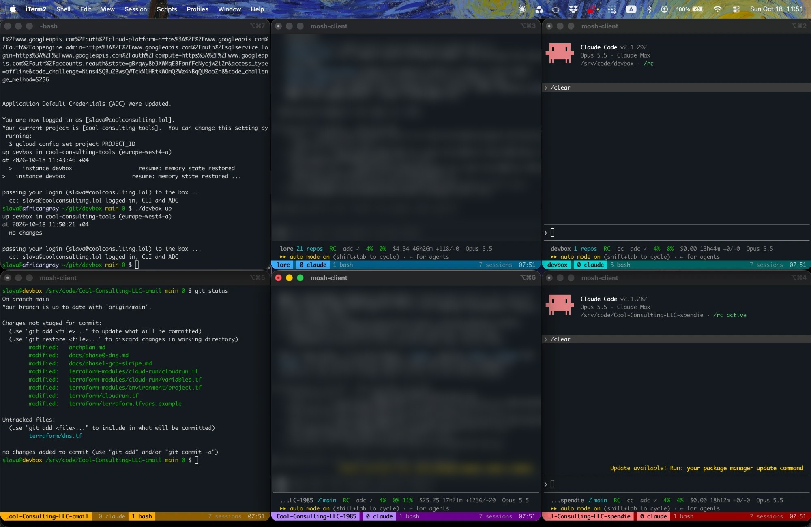

# devbox

A Claude Code workstation in your own GCP project, reachable over your tailnet, built and torn down by one static binary. No Terraform, no state file.



## Overview

`devbox` makes a GCP project match `devbox.yaml`: an Ubuntu VM you reach over Tailscale SSH or mosh, with Claude Code, `gh`, Terraform, Go, Node, uv, ruff, pytest and rootless Docker installed. Your work lives on `/srv/code`, a separate disk that is snapshotted daily and survives rebuilds. The box suspends itself after an hour idle and keeps its memory, so tmux and Claude Code sessions survive. It costs about $12 a month while suspended and about 15¢ an hour while running; see [Costs](#costs).

A dedicated SSH key in Secret Manager authenticates to GitHub and signs commits. Nobody has sudo on the box unless you opt into password sudo (see [Sudo](#sudo)), and agents are denied `git commit`, `git push` and applies.

### Security

`devbox` is for one person in a GCP project of their own. It is not a sandbox. Agents run as you, so they can use anything you can: the machine key, project secrets, and any gcloud login on the box. The deny rules stop accidents, not a determined or prompt-injected agent. Give the machine key as little reach as you can (a machine user or deploy keys), and protect your branches.

### Costs

Approximate monthly costs for the example `devbox.yaml` (e2-standard-4 in europe-west4, 80 GB of disk, external IP), at on-demand prices:

| | Per month |
|---|---|
| Disks, always | $9.60 |
| Memory while suspended, all month | $2.70 |
| Compute while running, all month | $108 |
| External IP while running, all month | $3.65 |
| **Suspended all month** | **about $12** |
| **Running 8 hours a weekday** | **about $40** |
| **Running all month** | **about $120** |

Running costs about 15¢ an hour. The total also includes snapshots, usually a few dollars, depending on how much `/srv/code` changes. Secret Manager and logging are usually pennies. Other regions cost up to about 20% more, and an e2-standard-N machine costs N/4 times the compute line. `./devbox status` estimates your box's costs from its actual uptime. Check the billing console for the real figure.

## How to set it up

You need a GCP project where you are owner, a Tailscale account, a GitHub account, and on the laptop: Go, `gcloud`, `tailscale`, `gh` and `mosh`.

### 1. Build

```bash
make setup     # builds ./devbox and creates devbox.yaml from devbox.example.yaml
```

In `devbox.yaml`, set `project_id`, `git.name`, `git.email` and `alerts.email`. Every key is in [docs/config.md](docs/config.md). Every `devbox` command logs you in to Google first when you are not, as `make auth` does.

### 2. Tailscale

In the access controls JSON editor, add the following, with your Tailscale login and your login name on the box. `./devbox preflight` prints the SSH rule with your values filled in.

```
"tagOwners": { "tag:devbox": ["autogroup:admin"] },
"ssh": [
  { "action": "accept", "src": ["you@example.com"], "dst": ["tag:devbox"], "users": ["you"] }
],
```

Then create an OAuth client under Settings → Trust credentials, with scope **Auth Keys (write)** and tag `tag:devbox`, and store its secret:

```bash
./devbox secret tailscale     # paste it at the hidden prompt
```

### 3. Machine key

```bash
./devbox secret ssh-key       # generates the key, stores it, adds it to GitHub to authenticate and sign
```

The key is made in memory and goes only to Secret Manager; no key file is written. `gh` asks for the `admin:public_key` and `admin:ssh_signing_key` scopes if it lacks them.

### 4. Create the box

```bash
./devbox preflight --fix     # checks everything; enables missing APIs and creates the network
./devbox up                  # creates the box, waits for provisioning, logs you in once
```

`--fix` gives the box a network of its own, `devbox` with subnet `devbox-europe-west4` (10.10.0.0/24), if they don't exist. GCP's `default` network opens SSH to the internet, and devbox refuses to use it.

Provisioning takes about 3 minutes, and `up` shows its log. It then logs you in once through IAP, which creates your account on the box. From then on, use Tailscale. Run `claude` on the box and log in.

## How to use it

```bash
./devbox up                                   # create what is missing; resume if suspended
mosh you@devbox -- ta main                    # or: ssh you@devbox
./devbox down                                 # suspend; sessions survive
./devbox status                               # what exists, its state, what it costs
```

If `ssh` hangs, the box has suspended itself: run `./devbox up`.

When your Google login expires, every `./devbox` command logs you in again first, as `make auth` does. `./devbox up` then passes the fresh login to every gcloud config on the box that is logged in as the same account, so you don't log in there again. Configs for other accounts still need `devbox-gcloud-login` on the box. The box needs `devbox-gcloud-adopt`, so run `./devbox reprovision` once after updating.

### Projects

```bash
./devbox project add git@github.com:acme/api.git --project acme --gcloud-config client-a --gcp-project acme-prod
./devbox project add git@github.com:acme/web.git --project acme
./devbox project secret acme OPENAI_API_KEY --recreate   # prompts; stored in Secret Manager; restarts the session
```

A project is a directory under `/srv/code` with its own tmux session, variables and secrets. Its repos, one or many, are subdirectories: here `/srv/code/acme/api` and `/srv/code/acme/web`. Start `claude` in the project root, where the session starts, so that one Claude Code session and its memory cover every repo. `devbox project add` writes a `CLAUDE.md` there listing the repos; say in it what each one is for. If the first repo you add has a `CLAUDE.md` of its own, the project's is a link to it instead, so git tracks it.

Secrets are read from Secret Manager into the session's environment when it starts, never written to disk. `--recreate` restarts the project's session so it has the new secret, killing whatever runs there. Without it, run `devbox-sessions --recreate acme` on the box when convenient. Log a gcloud config in with `devbox-gcloud-login client-a` on the box.

The non-secret variables also go into `.claude/settings.local.json`, in the project root and in each repo, for Claude Code started outside the session. Claude Code reads that file from the git root it starts in, never from a parent directory, hence the copies.

- `devbox project init NAME` makes a directory of repos you cloned by hand into a project.
- `devbox project nest NAME` moves a project made before this layout, which is a repo itself, into it. `--name` renames a project too, or only renames one: it moves the directory, the tmux session, the secrets and Claude Code's history and memory. Both restart the project's session.

### Changing the box

- Edit `devbox.yaml` or the files under `internal/assets/files/`, then run `make build`.
- Run `./devbox apply`. It changes what differs, then reprovisions in place if provisioning changed, and nothing is lost. Changes to the machine type, cloud-init or network restart or replace the VM, and it asks first. `--dry-run` shows the plan first. `/srv/code` always survives.
- `./devbox reprovision` reruns provisioning alone, changed or not.
- [docs/config.md](docs/config.md) says which keys need what.

If the tailnet is down, add `--iap`. If a new box hasn't joined the tailnet within an hour, run `./devbox reprovision --iap --rejoin`.

### Sudo

By default nobody can sudo. To allow it with a password, name a secret for its hash in `devbox.yaml`:

```yaml
sudo:
  password_secret: devbox-sudo-password-hash
```

Then run `./devbox secret sudo`. It asks for the password twice, stores its SHA-512 crypt hash, and reprovisions the box. You can then sudo anything after typing the password, and it asks every time. Agents can't type it, but they run as you, so a hostile one could plant a fake `sudo` and catch the password the next time you type it. The hash is readable on the box, so use a long password. To rotate it, run `./devbox secret sudo` again. To turn it off, set the key back to `""` and run `./devbox apply`.

### Tearing down

```bash
./devbox destroy          # keeps the code disk, its snapshots and secrets
./devbox destroy --all    # deletes everything devbox created
```

## License

[Apache 2.0](LICENSE).
