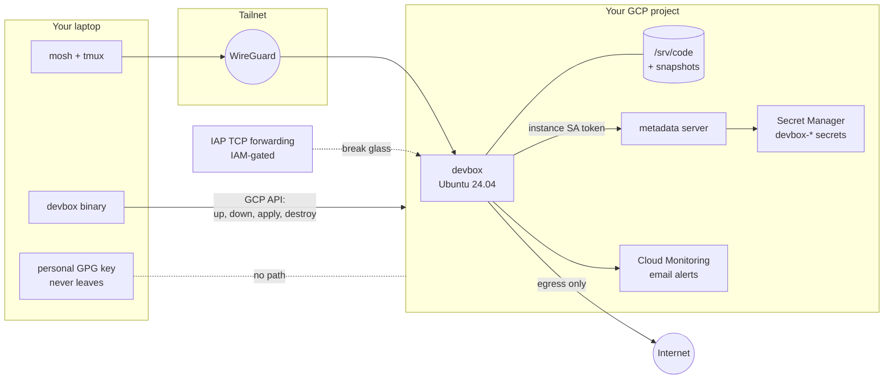
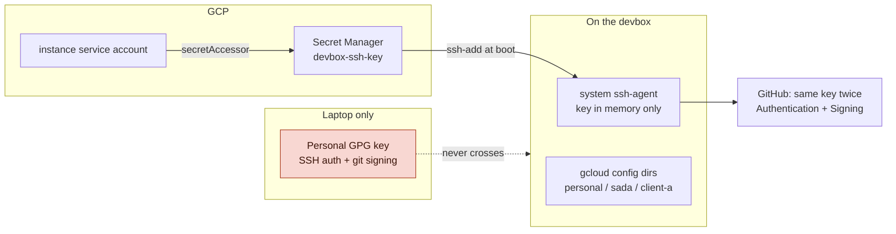
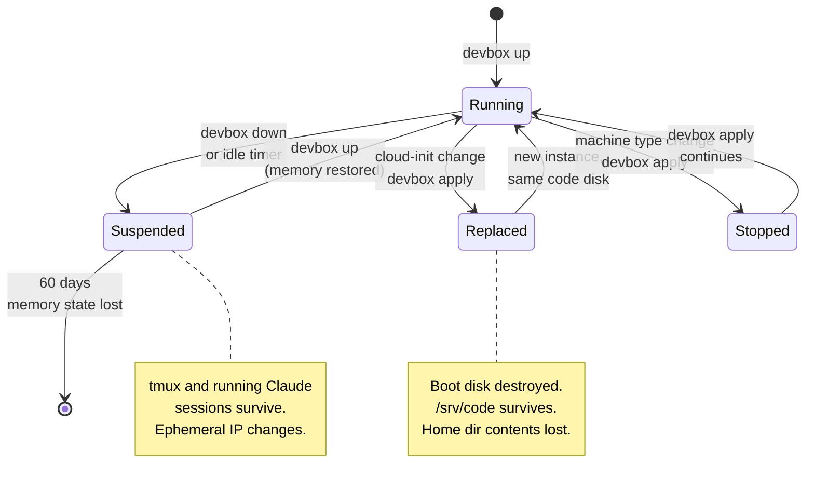

# Break-Glass Devbox

A single static binary that stands up a Claude Code workstation in a GCP project you own, reachable only over your tailnet, with a deliberate second way in for the day the tailnet is the thing that broke, a machine identity that keeps your personal key out of the cloud, and a destroy path that returns the project to how it started. No Terraform, no state file.

---

## Decisions locked in

| Decision | Choice | Why |
|---|---|---|
| **Deliverable** | One static Go binary, stateless | Thirteen cheap resources, enumerated by label and name prefix. No state bucket, no `terraform` dependency, no chicken-and-egg. |
| **Access assumption** | You hold editor or owner on the project | No Shared VPC machinery, no least-privilege gymnastics. |
| **Project and VPC** | Either `project_id` + existing VPC, or `create_project` | Exactly one is required. Creating the project is **backlogged**; the flag exists and refuses for now. |
| **Login model** | OS Login, enabled on the instance | `enable-oslogin=TRUE` is always accepted, including where an org enforces it. One account model everywhere, IAM-granted, no `ssh-keys` metadata and no `dev` user. |
| **Image** | `ubuntu-os-cloud` / `ubuntu-2404-lts-amd64` | Debian GCE images do not ship cloud-init and ignore `user-data` entirely. |
| **Region** | `europe-west3` (Frankfurt) | Armenian transit terminates there. See the region note. |
| **Machine type** | `e2-standard-2` | Cheapest, suspend-capable, and the only family that reports guest memory without an agent. |
| **State split** | Box is cattle, `/srv/code` is a pet | One disk holds everything durable, with a snapshot schedule. Everything else is replaceable on a whim. |
| **Dotfiles** | `/etc/skel` and `/etc/profile.d`, always | The only path that works when the account does not exist at provisioning time, which under OS Login it never does. |
| **Pause model** | Suspend, not stop | Suspend preserves guest memory, so tmux and running Claude Code sessions survive. |
| **Signing identity** | A new ed25519 key, in a system `ssh-agent`, never on disk | Your personal GPG key never reaches GCP. One secret, loaded into memory at boot. |
| **Agent credentials** | Same as yours | Agents debug with your SSH agent and your gcloud identity. The deny list and branch protection carry the no-commit, no-push, no-apply policy. |
| **Projects and their secrets** | A convention on the pet disk | Adding a project or a secret never edits the codebase. |
| **Documentation** | Six runbooks, one question each | A key deliverable, not an afterthought. Concise, copy-pasteable, tested on a clean laptop. This plan is the *why*; the runbooks are the *how* and never repeat it. |

### The shape of it



The binary talks to GCP directly and makes reality match `devbox.yaml`. cloud-init gets the box to the point where it can run `provision.sh` from the pet disk, and `provision.sh` does everything else. Nothing secret passes through instance metadata: the box fetches what it needs from Secret Manager using its own identity.

### A note on the region

Armenia is landlocked and roughly 85% of its international traffic goes north through Georgia to Poti, then across the Caucasus Cable System to Balchik in Bulgaria, then terrestrially to Frankfurt. TEAM Telecom Armenia's 400G circuit, live this year, routes Agarak to Tbilisi to Poti to Balchik to Sofia to Frankfurt and deliberately avoids Turkish terrestrial transit. So `europe-west3` is where the path already terminates.

Tel Aviv is the closest region on a map at about 1,250 km and also the cheapest, but the Armenia-Turkey border is closed and the Iran link is low capacity, so traffic almost certainly backhauls via Frankfurt and then south again. Warsaw is about 6% cheaper than Frankfurt and 750 km closer on the straight line, but the routing advantage is unproven.

> [!NOTE]
> **Measure before you commit.** Google's own guidance points at [gcping](https://gcping.com). Run it from Yerevan on the ISP that will actually serve you and compare `europe-west3`, `europe-central2` and `me-west1`. Frankfurt is the paper favourite; Tel Aviv is the one worth checking because it is both nearest and cheapest. Google announced a Türkiye region in late 2025 with no code or date, which would likely win if it lands.

Monthly on-demand for `e2-standard-2`: Frankfurt $63.03, Warsaw $59.19, Tel Aviv $53.81.

---

## Phase 0 — The executable

One Go binary. It compiles to a single static file, talks to GCP through the official SDK, and carries `cloud-init.yaml`, `provision.sh`, the dotfiles and the managed settings as embedded files. There is nothing else to install on the laptop.

```
devbox preflight              # read-only survey; --fix enables what it can
devbox up                     # create what is missing, resume if suspended
devbox down                   # suspend, preserving memory state
devbox status                 # what exists, its state, what it is costing
devbox apply [--dry-run]      # reconcile config to reality; prints the diff first
devbox reprovision            # push provision.sh from the repo and run it
devbox project add <repo>     # clone and register a project on the box
devbox project secret <name>  # store a project secret, reference it from the env
devbox destroy [--all]        # tear down; --all includes the code disk
```

One input file:

```yaml
# devbox.yaml. Exactly one of project_id or create_project.
project_id: my-devbox-project
create_project: false            # BACKLOGGED. Refuses today.

zone: europe-west3-b             # region is derived
name: devbox

network:
  name: default                  # an existing VPC in this project
  subnet: default

machine_type: e2-standard-2
code_disk_gb: 50
boot_disk_gb: 30

git:
  name: "Svyatoslav I. Maslennikov"
  email: me@smaslennikov.com

tailscale:
  tag: tag:devbox
  oauth_secret: devbox-tailscale-oauth   # Secret Manager name

alerts:
  email: slava@coolconsulting.lol
  cpu_high_pct: 80               # sustained 5m
  cpu_idle_pct: 5                # sustained 6h, see phase 10 for why
  disk_used_pct: 85

idle_suspend:
  enabled: true
  after_minutes: 60
```

### Why stateless

Every resource the binary creates is cheap, recreatable in seconds, and findable afterwards without a state file. Disks, instances, snapshot policies, secrets, notification channels and alert policies all take labels. Service accounts and firewall rules do not, so those are found by name prefix. Everything is labelled `devbox=<name>` where labels exist and named `<name>-*` everywhere.

That gives you the two things state was buying. `destroy` enumerates by label and prefix instead of reading a file. `apply --dry-run` compares what exists to what the config says and prints the operations it would perform, which is a smaller `plan` but the one you actually need for one box.

What you give up is drift detection on fields the binary does not manage. If you hand-edit the instance in the console, the binary will not notice unless the field is one it reconciles. For a machine you are the only user of, that is a fair trade for deleting a state bucket, a backend config and a sixty-megabyte dependency.

### The resource inventory

This is the whole thing. Each has an `ensure` that is idempotent: get, create if absent, update the managed fields if they differ.

| Resource | Found by | Managed fields | Destroyed by default |
|---|---|---|---|
| Code disk | label | size (grow only) | **No.** Needs `--all` and typing the disk name |
| Snapshot schedule + attachment | label | schedule, retention | Yes |
| Instance | label | machine type, metadata, service account, shielded config | Yes |
| Service account | name | roles | Yes |
| IAM bindings | by SA member | the three roles below | Yes |
| Secrets `devbox-*` | label | existence only, never contents | **No.** They may hold project secrets. `--all` |
| Firewall: IAP | name | source range, target SA | Yes |
| Firewall: break-glass | name | source CIDR, ports | Yes, and only exists when enabled |
| Notification channel | label | email | Yes |
| Alert policies (3) | label | thresholds, durations | Yes |

The service account gets exactly these: `secretmanager.secretAccessor` on every secret matching `devbox-*` through one IAM condition, `compute.instances.suspend` on its own instance through a custom role, and `logging.logWriter` plus `monitoring.metricWriter` for the Ops Agent.

### Destroy means destroy

```
devbox destroy          # everything above except the code disk and the devbox-* secrets
devbox destroy --all    # those too. Types the disk name to confirm.
```

Default destroy leaves the code disk, its snapshots, and your secrets, because those are the things that hold work. It never touches the project, the VPC or the subnet, because it did not create them, and it never changes API enablement, because it did not do that either.

> [!NOTE]
> **Go, not Python, and it is worth saying why.** You are the only user, and a Python script with `uv` inline dependencies would be finished sooner. Go wins on one thing: the requirement says a single executable, and Go is the only option that is literally one file on a fresh laptop with nothing installed. If that requirement softens, Python is the pragmatic choice and nothing else in this plan changes.

---

## Phase 1 — Preflight

A read-only survey, with `--fix` for the things the binary is allowed to change. Exits non-zero with one specific message per failure.

```
$ devbox preflight
  project          my-devbox-project          ok
  permissions      roles/owner                ok
  apis             compute, secretmanager,
                   iap, monitoring, oslogin   ok
  os login         your posix name: slava_c   ok
  network          default / default          ok
  zone/region      europe-west3-b             ok
  egress           external IP permitted      ok
  org policies     none enforced              ok
  suspend support  e2-standard-2, 8 GiB       ok
  tailscale        secret devbox-tailscale-oauth   MISSING  -> see below
```

| Check | What it prevents | `--fix` does |
|---|---|---|
| Owner or editor on the project | Everything downstream | nothing, tells you |
| APIs: compute, secretmanager, iap, monitoring, **oslogin** | Silent failures mid-`up` | enables them, printing each one. Never disables on destroy |
| **OS Login** | A box with no login account | reads your POSIX username via `gcloud compute os-login describe-profile` and records it for the Tailscale SSH policy. The instance sets `enable-oslogin=TRUE` itself, so nothing project-wide changes |
| `roles/compute.osAdminLogin` | Login without sudo | nothing, tells you. Owner already has it |
| `compute.vmExternalIpAccess` | `access_config` rejected at create | nothing, tells you to set `external_ip: false` and confirm NAT |
| `compute.requireShieldedVm` | Create rejected | nothing; shielded is on by default anyway |
| Private Google Access on the subnet | A box that boots and reaches nothing | nothing. Asks the NAT question out loud, since no API answers it |
| Zone inside the subnet's region | A `subnetwork not found` error that reads like a typo | nothing |
| Suspend eligibility | Blocked on GPUs, Confidential VMs, bare metal, over 208 GB | nothing |
| Tailscale OAuth secret exists | `provision.sh` failing at the join step | nothing. See the Tailscale setup below |

> [!NOTE]
> **OS Login is not on by default.** The project default is metadata SSH keys. Some organizations turn OS Login on by policy, which is probably what you are remembering. Setting `enable-oslogin=TRUE` on the instance rather than the project means no other VM in that project is affected, and it is always accepted, including under enforcement, because only `FALSE` is rejected. Your username on the box is derived from your email, visible with `describe-profile`, and sudo comes from `osAdminLogin`.

### Tailscale setup, done once by hand

The binary cannot do these because they live in the Tailscale admin console, not GCP. Preflight checks for the result.

1. **Define the tag** in your ACL policy with yourself as owner:
   ```json
   "tagOwners": { "tag:devbox": ["autogroup:admin"] }
   ```
2. **Create an OAuth client** under Settings, OAuth clients, with the `auth_keys` scope and `tag:devbox` assigned. A client with that scope is *required* to carry a tag, and every key it mints carries it, which is what lets the node join unattended.
3. **Store the client secret**: `printf '%s' "$SECRET" | gcloud secrets create devbox-tailscale-oauth --data-file=- --labels=devbox=devbox`
4. **Allow Tailscale SSH** to the box, as your OS Login user:
   ```json
   "ssh": [{ "action": "accept", "src": ["autogroup:member"],
             "dst": ["tag:devbox"], "users": ["slava_c", "root"] }]
   ```
   The username is the POSIX name preflight printed. Tagged devices can only SSH into other tagged devices, which is a containment property worth keeping.
5. **Tailscale Drive**, if you want the Finder mount:
   ```json
   "nodeAttrs": [
     { "target": ["tag:devbox"],       "attr": ["drive:share"] },
     { "target": ["autogroup:member"], "attr": ["drive:access"] }
   ],
   "grants": [{ "src": ["autogroup:member"], "dst": ["tag:devbox"],
                "app": { "tailscale.com/cap/drive": [{ "shares": ["out"], "access": "rw" }] } }]
   ```

---

## Phase 2 — Resources

What each one is and the detail that matters. No HCL any more; these are the `ensure` functions.

### Firewall: target the service account

```
name:          devbox-allow-iap-ssh
direction:     INGRESS
source_ranges: 35.235.240.0/20       # IAP TCP forwarding
allow:         tcp:22
target:        service account devbox@<project>.iam.gserviceaccount.com
```

> [!NOTE]
> **Still the service account, not a tag.** A network tag is a free-text field that anyone with `compute.instances.setTags` can attach to a VM of their own, inheriting your openings. Attaching a service account requires `roles/iam.serviceAccountUser` on it, so the target set is governed by IAM. Costs nothing. One constraint: tags and service accounts cannot be mixed in a single rule, in either position.

### The break-glass switch

A second rule, created only when enabled, scoped to your current address.

```yaml
break_glass:
  enabled: false
  source_cidr: ""          # your public IP as /32, never 0.0.0.0/0
  allow_mosh: false        # adds udp:60000-61000
```

The binary refuses `0.0.0.0/0` and refuses an empty CIDR when enabled. The IAP rule handles most Tailscale outages and needs no `apply` to use, because IAM gates it. This flag is for when you are somewhere `gcloud` and IAP are blocked but outbound 22 is not.

> [!CAUTION]
> **Keep the switch dumb.** Do not have it also reconfigure `sshd` in the guest. The break-glass path must work on the day everything else is broken. The firewall is the only gate, and `sshd` is hardened unconditionally so the gate is safe to open.

### Service account and roles

One account, three grants, nothing else:

```
secretmanager.secretAccessor   on secrets where resource.name startsWith "projects/<p>/secrets/devbox-"
devbox.selfSuspend             custom role: compute.instances.suspend, on the instance only
logging.logWriter, monitoring.metricWriter   for the Ops Agent
```

The IAM condition on the secret accessor is what lets `devbox project secret` add new secrets without touching IAM each time: anything named `devbox-*` is readable by the box, nothing else is.

---

## Phase 3 — Identity and keys

Your personal GPG key is your SSH key via `gpg-agent`'s `sshcontrol` and your git signing key, and it unlocks the laptop-side secret flow. None of it is going to GCP.

GCE hands you exactly one credential that arrives without a secret being planted first: the instance's service account token, from the metadata server. That is the hinge.



### A machine identity, in memory only

A new ed25519 keypair for automated deployment that never shares material with your personal key. It signs with SSH rather than GPG, which removes an entire agent from the plan. And it never touches the disk on the box: `provision.sh` fetches it from Secret Manager and pipes it straight into a system `ssh-agent`.

```bash
# on the laptop, once
ssh-keygen -t ed25519 -N '' -C 'devbox automation' -f devbox_ed25519
gcloud secrets create devbox-ssh-key --data-file=devbox_ed25519 --labels=devbox=devbox
shred -u devbox_ed25519
```

No passphrase, deliberately. The key exists in Secret Manager and in the agent's memory. A passphrase would sit in Secret Manager next to it with the same accessor and protect nothing.

```ini
# /etc/systemd/system/devbox-ssh-agent.service
[Unit]
Description=devbox system ssh-agent
After=network-online.target

[Service]
Type=simple
ExecStartPre=/usr/bin/install -d -m 0750 -g google-sudoers /run/devbox
ExecStart=/usr/bin/ssh-agent -D -a /run/devbox/ssh-agent.sock
ExecStartPost=/bin/chgrp google-sudoers /run/devbox/ssh-agent.sock
ExecStartPost=/bin/chmod 0660 /run/devbox/ssh-agent.sock

[Install]
WantedBy=multi-user.target
```

```bash
# provision.sh
export SSH_AUTH_SOCK=/run/devbox/ssh-agent.sock
ssh-add -l >/dev/null 2>&1 || \
  secret devbox-ssh-key | ssh-add -        # `secret` is a 4-line wrapper around the metadata token
```

The socket is group `google-sudoers`, which is the group OS Login puts admin users in. Anyone who can sudo on the box can use the key, which matches the threat model: they already have everything.

`/etc/profile.d/devbox.sh` exports `SSH_AUTH_SOCK=/run/devbox/ssh-agent.sock` for every login. The agent survives suspend because memory does. After an instance replacement, `provision.sh` reloads it.

> [!CAUTION]
> **Upload it to GitHub twice.** GitHub treats authentication keys and signing keys as separate objects even when the bytes are identical. Add the public key once with type **Authentication** and again with type **Signing**. Upload it once and you get working pushes plus commits that display as Unverified forever.
>
> GitHub documents no verified-email requirement for SSH signatures. An SSH key carries no identity to cross-check, so the signature is attributed to the account that owns the key.

### Git config

```ini
# /etc/skel/.gitconfig
[user]
    name = Svyatoslav I. Maslennikov
    email = me@smaslennikov.com
    signingkey = key::ssh-ed25519 AAAA...   # the public key, literal form
[gpg]
    format = ssh
[commit]
    gpgsign = true
[tag]
    forceSignAnnotated = true
[gpg "ssh"]
    allowedSignersFile = ~/.config/git/allowed_signers
```

The `key::` literal form is what you use when the private half lives only in an agent. Name, email and the public key are rendered into this file by `provision.sh` from `devbox.yaml`. `allowed_signers` is written beside it and is needed only to *verify* signatures locally, never to create them.

Version floors: git 2.34+, OpenSSH 8.8+. Ubuntu 24.04 clears both.

### What you give up with SSH signing

No trust model. A signature is either in `allowed_signers`, fully trusted, or it is not. Expiry and revocation live in files you maintain. For a machine identity that is fine, and `valid-before` buys you something GPG makes awkward: rotate the key and past signatures stay valid, because git checks validity as of the signature's own timestamp.

If the box is compromised: delete two GitHub key entries, `gcloud secrets delete devbox-ssh-key`, generate a new one, `devbox reprovision`.

---

## Phase 4 — Compute, disks and lifecycle

### The pet disk

`pd-balanced`, labelled, grown but never shrunk, never deleted without `--all` and the disk name typed back. Daily snapshots at 03:00, fourteen days of retention, snapshots kept if the disk is ever deleted.

Start at 50 GB. The disks are the floor of your suspended cost, growing is non-destructive, and shrinking is impossible.

### The instance

The fields that matter:

```
machine_type:     e2-standard-2
boot disk:        ubuntu-2404-lts-amd64, 30 GB pd-balanced
attached disk:    the code disk, device name "code"
network:          the existing subnet; external IP unless external_ip: false
shielded:         secure boot, vTPM, integrity monitoring
service account:  devbox@..., scope cloud-platform
labels:           devbox=<name>
metadata:
  enable-oslogin: TRUE
  user-data:      the embedded cloud-init
```

Two things in there that look optional and are not. The `cloud-platform` scope: the default access scopes do not include compute, so a box built with defaults cannot suspend itself regardless of IAM. And `enable-oslogin=TRUE`: the only account model this plan has.

### Is your data safe when you change things?



| What you change | What `apply` does | Data |
|---|---|---|
| `machine_type` | Resume if suspended, stop, set type, start | Safe. Both disks survive a stop. Memory state is lost, which is unavoidable |
| `code_disk_gb` (grow) | Resize in place, `provision.sh` grows the filesystem | Safe |
| cloud-init or `provision.sh` baked parts | Resume if suspended, delete the instance, recreate it, reattach the code disk | `/srv/code` survives. Home directories do not |
| Alerts, firewall, IAM, snapshots | Updated in place | Nothing touches the instance |

> [!NOTE]
> **The landmine is gone, by construction.** Under Terraform, a `machine_type` change against a suspended instance skipped the stopping guard and silently lost the memory state. Now the sequence is your code: `apply` always resumes first, then stops properly. There is no provider to surprise you.

The resilience contract is one sentence: **anything you care about lives on `/srv/code`, or it does not survive a replacement.** `~/.claude`, the gcloud config directories and the project list all live there and are symlinked in.

---

## Phase 5 — Provisioning

Two layers with different change costs.

**cloud-init**, baked into the instance. Changing it replaces the VM. It does as little as possible: format the code disk on first boot only, mount it at `/srv/code`, install the base packages, write the `sshd` drop-in and `managed-settings.json`, enable the `ssh-agent` unit, and run `provision.sh`.

**`provision.sh`**, the canonical copy in the repo, embedded in the binary. `devbox reprovision` pushes it to `/srv/code/.devbox/provision.sh` over Tailscale SSH and runs it. The copy on the disk is a cache, never the source. Edit the repo, run `reprovision`, done in thirty seconds with no replacement and no lost session.

```ini
[Unit]
Description=devbox provisioning
After=google-guest-agent.service network-online.target devbox-ssh-agent.service
Wants=network-online.target

[Service]
Type=oneshot
ExecStart=/srv/code/.devbox/provision.sh
RemainAfterExit=yes
```

### Packages

`tmux`, `mosh`, `git`, `ripgrep`, `fd-find`, `jq`, `build-essential`, `rsync`, `syncthing`, `google-cloud-cli`, `direnv`, the Ops Agent, and whatever runtimes your projects need.

### Dotfiles to /etc/skel, always

```
/etc/skel/
├── .bashrc              # plain ssh-agent socket, not gpg-agent
├── .gitconfig           # rendered from devbox.yaml
├── .tmux.conf
├── .config/git/allowed_signers
└── .ssh/config

/etc/profile.d/
└── devbox.sh            # SSH_AUTH_SOCK, PATH, the session helpers
```

Under OS Login there is no home directory until first login, so nothing can be written into one at provisioning time. `/etc/skel` is copied into every account at creation, whenever that happens, and `/etc/profile.d` applies to everyone regardless. The guest-agent race that would otherwise matter here does not, because nothing waits for a user to exist.

The `.bashrc` is your ported one with the two GPG lines swapped for the agent socket. Add a `make diff-dotfiles` target comparing this copy against your Ansible role's, so the drift stays visible.

### Tailscale

```bash
secret devbox-tailscale-oauth > /run/ts.key
chmod 600 /run/ts.key
printf '?preauthorized=true&ephemeral=false' >> /run/ts.key

tailscale up \
  --auth-key=file:/run/ts.key \
  --advertise-tags=tag:devbox \
  --hostname=devbox \
  --accept-dns=false \
  --ssh

shred -u /run/ts.key
```

`--accept-dns=false` keeps MagicDNS from displacing GCP's internal resolver, which you need on a box that talks to `metadata.google.internal`. `--ssh` claims port 22 for the tailnet address only, leaving your real `sshd` serving every other interface, which is what makes the break-glass path independent. Do not also pass `--shields-up`: it refuses all incoming tailnet connections, including the SSH you just enabled.

### Hardened sshd

```
PermitRootLogin no
PasswordAuthentication no
KbdInteractiveAuthentication no
MaxAuthTries 3
LoginGraceTime 20
X11Forwarding no
AllowTcpForwarding yes
KexAlgorithms curve25519-sha256,curve25519-sha256@libssh.org
Ciphers chacha20-poly1305@openssh.com,aes256-gcm@openssh.com
MACs hmac-sha2-512-etm@openssh.com,hmac-sha2-256-etm@openssh.com
```

Applied unconditionally. `AllowTcpForwarding` stays on because IAP needs it and so does a port-forward to look at a dev server in your laptop's browser.

### Claude Code from the signed repo

```bash
install -d -m 0755 /etc/apt/keyrings
curl -fsSL https://downloads.claude.ai/keys/claude-code.asc \
  -o /etc/apt/keyrings/claude-code.asc
gpg --show-keys /etc/apt/keyrings/claude-code.asc \
  | grep -q 31DDDE24DDFAB679F42D7BD2BAA929FF1A7ECACE

echo "deb [signed-by=/etc/apt/keyrings/claude-code.asc] \
https://downloads.claude.ai/claude-code/apt/stable stable main" \
  > /etc/apt/sources.list.d/claude-code.list
apt-get update && apt-get install -y claude-code
```

Package-manager provenance and a pinnable fingerprint beat `curl | bash` on a machine built by a tool. The `stable` channel runs about a week behind and skips releases with major regressions.

---

## Phase 6 — The session layer

### Log in to Claude Code, properly

Run `claude` over SSH and let it print the login URL. Press `c` to copy it, open it on your laptop, and when the browser shows a code instead of redirecting back, paste that code at the `Paste code here if prompted` prompt. This gives you a real subscription login, so Remote Control and claude.ai connectors both work. `CLAUDE_CODE_OAUTH_TOKEN` is the wrong credential: those tokens can only make model requests and are explicitly rejected for Remote Control.

`~/.claude` lives on `/srv/code` and is symlinked, so a rebuilt instance does not make you log in again.

> [!CAUTION]
> **Diarise this.** A `/login` credential expires. Claude Code warns three days out at startup, but a background session that outlives the credential just stops making progress. On a box whose purpose is long-running sessions, that is the failure most likely to actually bite.

### gcloud, one config directory per identity

```
/srv/code/.gcloud/
├── personal/
├── sada/
└── client-a/
```

`gcloud config configurations` switches which project and account are *selected*, but every named configuration reads the same `credentials.db` and the same single ADC file. `CLOUDSDK_CONFIG` is the only mechanism that separates credentials.

> [!WARNING]
> **`CLOUDSDK_CONFIG` does not isolate Terraform or Node tools.** gcloud honours it, and so do the Python and Java client libraries. **Go and Node do not**, and look only at `$HOME`. A shell pointed at client-a runs `gcloud` as client-a and `terraform` as whatever is in `~/.config/gcloud`, with no warning. Always export `GOOGLE_APPLICATION_CREDENTIALS` alongside it, into the same directory.

> [!WARNING]
> **And on this box, the fallback is silent.** ADC resolves `GOOGLE_APPLICATION_CREDENTIALS`, then the gcloud ADC file, then **the metadata server**. On GCE that last step always succeeds. A tool with no ADC configured does not error; it authenticates as the box's own service account and you find out through a confusing 403 against the project you meant.

Headless auth, per config directory, twice:

```bash
export CLOUDSDK_CONFIG=/srv/code/.gcloud/client-a
gcloud auth login --no-launch-browser
gcloud auth application-default login --no-launch-browser
```

`--no-launch-browser` prints a URL you open anywhere and asks for a code back. `--no-browser` is a different flag that needs a second machine with gcloud installed. Neither is deprecated.

### Per-project environment and secrets

Every project is a directory on the pet disk with an env file. `devbox-sessions` creates one tmux session per directory that has one, and `tmux new-session -e` writes each line into the *session* environment so every window and pane created later inherits it. `new-window -e` is one-shot and does not even reach panes split within the same window, which is why it is the wrong tool.

```
/srv/code/acme-api/
├── .devbox-env
└── .claude/settings.json      # the same vars in an env block, for agent sessions
```

```bash
# .devbox-env
CLOUDSDK_CONFIG=/srv/code/.gcloud/client-a
GOOGLE_APPLICATION_CREDENTIALS=/srv/code/.gcloud/client-a/application_default_credentials.json
CLOUDSDK_CORE_PROJECT=acme-prod
CLOUDSDK_COMPUTE_REGION=europe-west2
GOOGLE_CLOUD_PROJECT=acme-prod
KUBECONFIG=/srv/code/.gcloud/client-a/kubeconfig
OPENAI_API_KEY=@secret:devbox-acme-api-OPENAI_API_KEY
DATABASE_URL=@secret:devbox-acme-api-DATABASE_URL
```

Lines whose value starts with `@secret:` are resolved by `devbox-sessions` at session creation, through the box's own service account, and land only in the tmux session environment. They are never written to disk. After suspend and resume the session memory survives, so they are still there. After a replacement the sessions are recreated and the secrets fetched again.

```bash
devbox project secret acme-api OPENAI_API_KEY        # reads the value from stdin
```

That stores `devbox-acme-api-OPENAI_API_KEY` in Secret Manager with the `devbox` label, and appends the reference line to the project's `.devbox-env`. The IAM condition from phase 2 means the box can read it immediately with no IAM change. For a project that insists on a `.env` file rather than environment variables, the loader renders one at session start from the same values, and you accept that it is on the pet disk.

direnv is layered on top for ad-hoc `cd`, but it cannot be the only definition: it hooks the interactive prompt, and Claude Code's Bash tool runs non-interactively, so `.envrc` never fires for an agent. The `.claude/settings.json` env block is how agents get the same environment, and it must not contain `@secret:` references, since nothing resolves them there. Keep secrets to the tmux session, which agent sessions started inside it inherit anyway.

### tmux settings that matter for a TUI

```tmux
set  -g default-terminal "tmux-256color"
set  -ga terminal-overrides ",*256col*:Tc"
set  -g mouse on
set  -s escape-time 10
set  -g history-limit 50000
setw -g aggressive-resize on
```

`escape-time` is the one people forget. The default 500 ms makes every escape sequence in a TUI feel like a bad connection, and you will blame the WAN.

---

## Phase 7 — Guardrails

Agents get your SSH agent and your gcloud identity, because you need them able to debug aggressively: read logs, inspect state, run `terraform plan`, poke at a broken service over SSH. What remains off limits is committing, pushing and applying.

> [!CAUTION]
> **Be clear-eyed about what this is.** With the agent socket present, "agents do not commit or push" is a policy, not a boundary. Claude Code's own documentation says Bash permission patterns that constrain arguments are fragile, and that rules are enforced by Claude Code rather than by the model. A rule denying `Bash(git push *)` does not stop `git  push` with two spaces, `eval "git push"`, or `sh -c 'git push'`. You have traded a hard guarantee for debugging reach. That is a legitimate trade, and the plan should not pretend otherwise.

Three layers.

**Managed settings, written by cloud-init.** `/etc/claude-code/managed-settings.json` outranks user settings, project settings and command-line flags. Root-owned, so the login user cannot edit it without sudo.

```json
{
  "permissions": {
    "deny": [
      "Bash(git commit *)",
      "Bash(git push *)",
      "Bash(terraform apply *)",
      "Bash(terraform destroy *)",
      "Bash(devbox apply *)",
      "Bash(devbox destroy *)"
    ],
    "disableBypassPermissionsMode": "disable"
  },
  "allowManagedPermissionRulesOnly": true
}
```

`disableBypassPermissionsMode` removes `--dangerously-skip-permissions` from the CLI entirely. `allowManagedPermissionRulesOnly` drops user and project permission rules rather than merging them, so a `.claude/settings.json` in a repo you cloned cannot widen anything.

**A `PreToolUse` hook.** Runs before permission rules are evaluated and inspects the raw command with a real regex, catching the whitespace and `eval` variants the globs miss.

```bash
#!/bin/bash
cmd=$(jq -r '.tool_input.command // ""')
if grep -qE '(^|[;&|(]|eval[[:space:]]+.?)[[:space:]]*(git[[:space:]]+(commit|push)|terraform[[:space:]]+(apply|destroy)|devbox[[:space:]]+(apply|destroy))' <<<"$cmd"; then
  jq -n '{hookSpecificOutput:{hookEventName:"PreToolUse",
          permissionDecision:"deny",
          permissionDecisionReason:"Commits, pushes and applies are yours."}}'
fi
exit 0
```

**Branch protection, which is the real backstop.** Since the in-guest controls are policy rather than boundary, the thing that actually prevents damage is server-side. Require pull requests on `main` for every repo that matters. That is enforced where an agent on this box has no reach.

> [!NOTE]
> **Honest about who this stops.** You have sudo. Managed settings do not defend against you; they defend against an agent, a careless flag, and a repo you cloned that ships its own settings file. That is the actual threat model.

---

## Phase 8 — Moving files

| The job | Use |
|---|---|
| Grab a file off the box, now | `tailscale serve --bg /srv/code/_out`, then `curl -C -` to resume |
| Push or pull a directory | rsync over SSH |
| Keep a folder continuously in step | Syncthing, own discovery disabled |
| Browse and edit a few files from Finder | Tailscale Drive |
| Something enormous, or a client handoff | A GCS bucket |

> [!CAUTION]
> **Not Samba.** SMB is a block protocol, not a streaming one. Microsoft's own write-up decomposes a 1 MB read into a create plus roughly seventeen sequential 61440-byte round trips, each costing at least the full link latency. Directory listings are capped at a smaller buffer than file reads, which is why *browsing* a share feels worst. SMB signing, which you would want on, disables large writes.

> [!CAUTION]
> **Taildrop will not work here.** Tailscale documents that you cannot send files to or from tagged nodes. The restriction is specific to Taildrop: Tailscale Drive works fine on a tagged node, and `tailscale serve` covers pulls. Keep the tag, which is what lets the node join unattended.

```bash
rsync -aHAX --info=progress2 --partial-dir=.rsync-partial \
      -z --compress-level=3 --timeout=120 \
      -e 'ssh -o ControlMaster=auto -o ControlPath=~/.ssh/cm-%C \
          -o ControlPersist=10m -o ServerAliveInterval=15' \
      ./dataset/ devbox:/srv/code/proj/dataset/
```

`--partial-dir` is the resume mechanism, **not `--append-verify`**, which is documented as dangerous unless every file is a known append-only growing file. `--info=progress2` gives whole-transfer progress. `--timeout` defaults to zero, so a dead link hangs forever without it. SSH connection multiplexing is the flag people skip and the one that matters most at high round-trip time.

rsync 3.5.0 shipped in August 2026 as a major security release, so pin current versions on both ends. And rsync does not work over mosh at all: mosh supports no non-interactive use and no port forwarding. Shell over mosh, files over ssh.

Share `_out`, never `/srv/code`, since one box holds several clients' source and a serve or share on that path publishes a browsable index of all of it to your whole tailnet.

---

## Phase 9 — Suspend, resume and what it costs

Suspend rather than stop. Suspend sends the guest an ACPI S3 signal and saves guest OS memory, device state and application state to persistent storage, restoring it on resume. **tmux and any running Claude Code sessions survive.**

`devbox down` suspends. `devbox up` creates if absent and resumes if suspended, so there is one command either way.

### What it costs while down

vCPU charges stop. Memory is rebilled under a "VM state: suspended RAM" SKU at roughly $0.000233 per GiB-hour, about $0.17 per GiB-month. Disks bill normally. The ephemeral external IP is released on suspend and stops billing.

For an `e2-standard-2` in Frankfurt with a 30 GB boot disk and a 50 GB code disk:

| | Running | Suspended |
|---|---|---|
| Compute | $63.03/mo | $0 |
| Suspended memory (8 GiB) | n/a | ~$1.36/mo |
| Disks (80 GB at $0.12) | ~$9.60/mo | ~$9.60/mo |
| External IP | ~$3.65/mo | $0, released |
| **Total** | **~$76/mo** | **~$11/mo** |

Run it eight hours a day on weekdays, roughly a quarter of the hours, and you land near $27/month against $76. The disks are the floor.

### Waking it up

The trigger has to go through the GCP API, because a suspended box is off the tailnet. `devbox up` from your laptop is the mechanism and needs nothing deployed. A Cloud Run endpoint for phone use is in the backlog; build it when you want the box from a phone more than once.

### Idle suspend

No Google-provided mechanism does this. Instance schedules and run-time limits both support **stop only**, never suspend, and in-guest `systemctl suspend` is explicitly ignored. So it is a systemd timer calling the API against itself.

```bash
#!/bin/bash
# /srv/code/.devbox/idle-check.sh, run by a root systemd timer every 5 minutes
THRESHOLD=${1:-60}

# This runs as root, so `tmux list-clients` alone would only see root's
# server. Walk every user's socket instead.
tmux_clients=0
for sock in /tmp/tmux-*/default; do
  [ -S "$sock" ] || continue
  n=$(tmux -S "$sock" list-clients 2>/dev/null | wc -l)
  tmux_clients=$(( tmux_clients + n ))
done

# Established connections to port 22 cover sshd, Tailscale SSH and the
# mosh bootstrap. More reliable than `who`, which Tailscale SSH may not
# register in.
ssh_conns=$(ss -Htn state established '( sport = :22 )' | wc -l)
mosh_conns=$(pgrep -c mosh-server || true)
claude_procs=$(pgrep -c -x claude || true)

busy=$(( tmux_clients + ssh_conns + mosh_conns + claude_procs ))

if [ "$busy" -gt 0 ]; then
  date +%s > /run/devbox-last-active
  exit 0
fi

last=$(cat /run/devbox-last-active 2>/dev/null || echo 0)
idle_min=$(( ( $(date +%s) - last ) / 60 ))
[ "$idle_min" -lt "$THRESHOLD" ] && exit 0

ZONE=$(curl -s -H 'Metadata-Flavor: Google' \
  http://metadata.google.internal/computeMetadata/v1/instance/zone | cut -d/ -f4)
gcloud compute instances suspend "$(hostname)" --zone="$ZONE" --quiet
```

A detached tmux session does not count as busy, deliberately. If it did, the box would never suspend. Attached clients, live connections and running `claude` processes are the signals.

### The caveats

> [!CAUTION]
> **Do not promise yourself a resume time.** Google documents no resume latency, no range and no SLO, and the managed-instance-group docs warn that restoring memory from storage "might take more time than restarting the VM or creating a new VM from scratch." Benchmark at your memory size. Your five-minute tolerance is probably fine, but it is a guess until measured.

> [!CAUTION]
> **Sixty days is a hard ceiling.** After sixty days in SUSPENDED, Compute Engine moves the instance to TERMINATED and the memory state is lost. Irrelevant for a box you touch weekly, fatal if you suspend it and go away for a season.

Smaller things: the guest must answer the ACPI signal within three minutes or the suspend fails. Suspend needs enough regional `DISKS_TOTAL_GB` quota to hold the memory image. And `apply` always resumes before changing anything, which is now your code's rule rather than a provider's quirk.

---

## Phase 10 — Monitoring and alerts

Three policies, one email channel.

| Policy | Condition | Why |
|---|---|---|
| CPU high | above 80% for 5 minutes | The box is undersized for what you are doing |
| CPU idle | below 5% for 6 hours | **Idle-suspend has failed.** With a 60-minute idle timer, a running box that stays idle for six hours can only mean the timer is broken. This is the alert that catches that |
| Disk full | `/srv/code` above 85% | The one failure with no other warning |

Email channels need no verification step, unlike SMS. If you ever point one at a group address, configure the group to accept mail from `alerting-noreply@google.com`.

The CPU policies use `compute.googleapis.com/instance/cpu/utilization`, which is a 0.0 to 1.0 fraction, so the thresholds are `0.8` and `0.05`, not 80 and 5. The disk policy uses `agent.googleapis.com/disk/percent_used` with `state="used"` and `device` matching the code disk, which is why the Ops Agent is installed. Policies are pinned to the instance by its **numeric** `instance_id`, the only selector that works across both metric domains.

> [!CAUTION]
> **`evaluation_missing_data` is not optional.** A suspended box reports no metrics. The default, `NO_OP`, leaves an already-open incident open until auto-close, whose own default is seven days. `ACTIVE` evaluates missing data as *true*, which on the idle policy means a false alert every time you suspend. `INACTIVE` closes open incidents and opens none, and is the only correct setting here. It requires a `duration` of at least 60 seconds.

E2 is the only family that reports guest memory without an agent, through the balloon metrics. That is a quiet argument for staying on E2.

### Cost

Alert policies are free today; the pricing page lists $0.35 per metric reference per month from **September 1, 2027**. All `compute.googleapis.com` metrics are free. Ops Agent metrics are chargeable beyond 150 MiB per billing account per month, which one VM should sit inside.

---

## Working on it

### Adding a project

```bash
devbox project add git@github.com:acme/api.git \
  --gcloud-config client-a \
  --gcp-project acme-prod \
  --region europe-west2
```

Clones into `/srv/code/acme-api/`, writes `.devbox-env` from the flags, writes the matching `.claude/settings.json` env block, creates the tmux session. Secrets come after, one command each, per phase 6. The binary never needs rebuilding and nothing in the repo changes. A rebuilt box comes back with the same projects because the directories are on the disk that survives everything.

### Making changes while working on the box

| Change | Cost | What lives here |
|---|---|---|
| **Live** | Nothing | Anything under `/srv/code`, env files, tmux config, Claude settings, `/etc/skel` for *future* accounts |
| **Reprovision** | ~30 seconds, no replacement | Everything `provision.sh` does: dotfiles, agent key, Tailscale, Claude Code, runtimes, git config |
| **Replace** | ~2 minutes, session lost | Package list, systemd units, `sshd` config, managed settings, anything in cloud-init |

Push as much as possible into `provision.sh`. Develop replacement-tier changes against a throwaway second instance:

```bash
devbox up --name devbox-test --code-disk-gb 20
# iterate until the cloud-init change is right
devbox destroy --name devbox-test --all
devbox apply
```

Everything is parameterised by name, so the second instance is free. This is the habit that stops you SSHing in to fix things by hand, which within a month leaves you with a machine nobody can rebuild.

---

## Documentation, the other deliverable

The binary is half the product. The other half is six short runbooks that let you, on a new laptop at an hour when you are not thinking clearly, do the six things you will actually need to do. Each answers one question, in its first line, with commands you can paste.

| Doc | The one question | Must contain | Length |
|---|---|---|---|
| `01-first-run.md` | From nothing to a shell on the box? | Laptop prerequisites (gcloud auth, the binary). The Tailscale admin steps, numbered. `devbox preflight`, what each failure means and what fixes it. `devbox up`. First SSH. Claude Code login over SSH. | One screen |
| `02-config.md` | What does each value in `devbox.yaml` do? | Every key: type, default, what it changes, and which change tier it triggers (live, reprovision, replace). **Generated** by `devbox config --describe` so it cannot drift from the code. | Reference, one line per key |
| `03-teardown.md` | How do I bring it down cleanly, and know it is down? | `down` versus `destroy` versus `destroy --all`: what each leaves and what it costs afterwards. How to verify with `devbox status` and with raw `gcloud` lists for a manual audit. How to restore `/srv/code` from a snapshot. | One screen |
| `04-changes.md` | How do I change something without losing my session? | The three-tier table. The throwaway `--name devbox-test` workflow. `reprovision` versus `apply`. | One page |
| `05-files.md` | How do I get a file in or out? | The five-row job table. The rsync one-liner. `tailscale serve` for a pull. The Finder mount. Nothing about why not Samba. | One screen |
| `06-projects-and-secrets.md` | How do I add a project, and give it a secret? | `devbox project add`. `devbox project secret`. The `@secret:` convention, where values live and where they never go. Rotating one. Removing one. | One screen |

Secrets and projects share a doc because you cannot add a secret without a project to attach it to.

### The discipline

- **The plan is not the docs.** This document holds every reason. The runbooks hold none. They link here for rationale and never restate it. A runbook that explains *why* has failed.
- **Every command pastes.** No `<placeholder>` unless the same doc tells you where to get the value, one line earlier.
- **`devbox --help` is part of the docs.** Each subcommand's help text must agree with its runbook. When they drift, the help text is wrong.
- **Doc 1 is the acceptance test.** Before a release, run it verbatim on a machine that has never seen the binary. If a step needs knowledge the doc did not give you, the doc is incomplete and the release is not done.
- **Doc 2 is generated**, never hand-edited, because a config reference that can drift from the code is worse than none.
- **One screen means one screen.** If a runbook grows past it, something belongs in the binary instead, usually as a better error message.

---

## What we are not using Ansible for

Nothing. Ansible entered this conversation because you pointed me at your repo for the `sshcontrol` and ssh config pieces, which were the right reference. The vault came up because your GPG key is that repo's root of trust and I was working out whether the devbox needed the same chain. You chose to port the dotfiles instead, which removed Ansible from this build.

The only remaining relevance is a boundary: your laptop keeps its GPG key, its `sshcontrol`, its vault and the playbook, and this box shares none of it. The `/etc/skel` dotfiles are a second copy of a subset of your role's files, and `make diff-dotfiles` keeps the drift visible.

---

## Backlog

**Create the project, VPC and supporting infra.** The `create_project` flag exists and refuses today. When built it needs a billing account, a folder or org id, project creation, API enablement on a project it genuinely owns, a VPC and subnet with Private Google Access on, optional Cloud NAT, and a destroy that deletes the project outright.

**A Cloud Run resume endpoint**, for waking the box from a phone.

**A Cowork-capable second box**, which needs nested virtualization and therefore cannot be E2.

---

## Still open

| Question | Default | What would change it |
|---|---|---|
| **Region** | `europe-west3` | gcping from Yerevan on your actual ISP |
| **Runtimes** | System packages | If projects disagree about Node or Python versions, a version manager in `provision.sh` |
| **Claude Code channel** | apt, `stable` | A week behind, skips major regressions |
| **Idle threshold** | 60 minutes | Measure your resume time first |

---

## Sharp edges

| Claim | Confidence | How to check |
|---|---|---|
| tmux survives suspend/resume | Strongly implied, never stated in process terms | Test it on day one |
| Resume completes in under five minutes | **Undocumented.** Can exceed a cold boot | Benchmark at your memory size |
| Tailscale SSH sessions appear in `who` | Unknown | The idle script counts port-22 connections instead. Confirm `ss` sees them |
| Email channels need no verification | Inferred from console flow and enum semantics | Create one and read back `verification_status` |
| Deny rules stop an agent pushing | Documented as best-effort, and now the only in-guest layer | Branch protection is the real backstop |
| `allowManagedPermissionRulesOnly` keeps project `env` blocks | Docs say it drops *permission* rules only | Confirm the env block survives before relying on it |
| `CLOUDSDK_CONFIG` isolates Terraform | It does not. Go and Node ignore it | Verified in client library source |
| Named gcloud configurations separate credentials | They do not. One shared store | `credentials.db` sits at the config-dir root |
| Taildrop works on the devbox | It does not, because the node is tagged | `tailscale file cp --targets` should not list it |
| A Cloud NAT covers your subnet | Cannot be verified by API | Preflight asks; it cannot confirm |
| SSH signatures need no verified email on GitHub | Documented absence, not a guarantee | Push one commit and look at the badge |
| mosh works over Tailscale SSH | Undocumented either way | Mosh over real `sshd` on the tailnet is the safe configuration |
| `google-sudoers` is where OS Login puts admins | Documented for the guest agent | Confirm with `id` after first login before relying on the socket group |

---

> **Build order.** Phase 0 through 4 give you a binary that stands up a closed, reachable, destroyable box. Write docs 1 and 3 at that point and run doc 1 on a clean machine; that is the first release. Use it for a week before building the session layer, because the session layer is the part you will keep changing for months, and write the remaining runbooks as each piece lands rather than at the end.

*Sources: Compute Engine docs on images, metadata, OS Login, org policy, suspend/resume, instance lifecycle and snapshot schedules; Cloud Monitoring metric references, alert policy semantics and observability pricing; Tailscale docs on auth keys, ACL tags, OAuth clients, Tailscale SSH, Taildrop, Taildrive and Serve; git and OpenSSH on SSH signing; GitHub on commit signature verification; Claude Code setup, authentication, permissions and hooks docs; and Caucasus Cable System and Armenian transit reporting for the region choice. Pricing and image family names change; verify both before you apply.*
